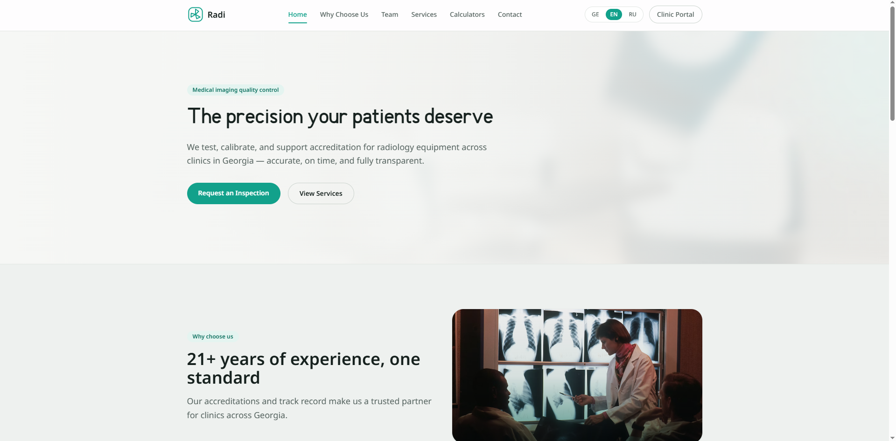
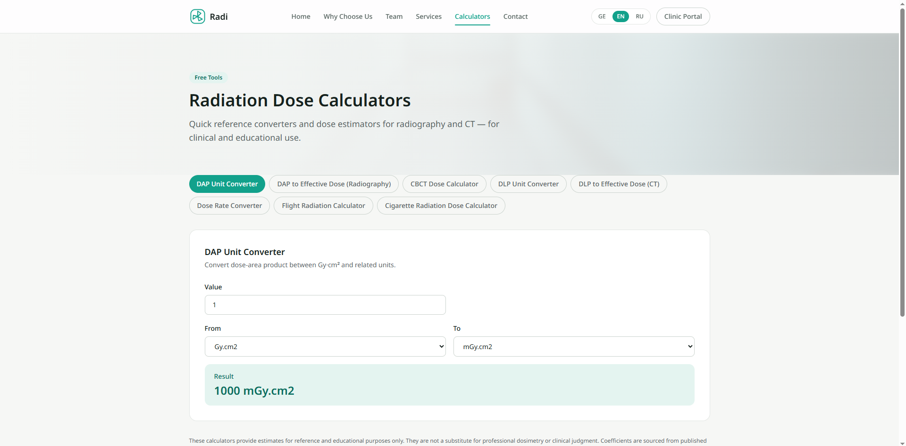
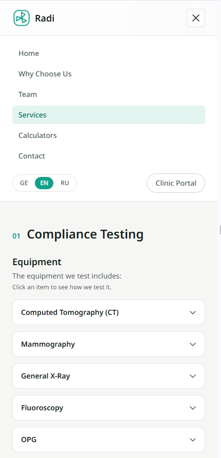

# Radi Inspection Services — Main Website (Radi.Ge):

Radi's Main Markenting Website Operating in Georgia, English, Russian. Website Has: Top Employee List, Services, Radiology Calculator, Basic Info & Contact

Website is Built with **Next.js**, **TypeScript**, **Tailwind CSS v4** and **next-intl**, website is deployed to/with **Cloudflare Workers** with automatic deploys from GitHub private Repo, access by only developer & CEO/admins.

## Features:

- **Full i18n (ge / en / ru)** Georgian is the default languge because wast majority of users are georgina, all copy of site lives in plain JSON files (`messages/`). this is by design, so that non developers can edit it very easly.

- **Radiation dose calculator** eight client-side tools with live-updating results, pulled from international standarts:
  DAP unit converter - DAP - effective dose (radiography, 24 exam types) - CBCT dose by field-of-view - DLP unit converter - DLP - effective dose (CT, by patient age and body region) - dose-rate converter - flight radiation - cigarette radiation.
  detailed information can be found at the end.

- **Services page** each is expandable by simple click and explains what Radi do.

- **Team section** 3-2-3 layout.

- **Responsive and theme-aware** site is suitable to mobile too with usage of "Tailwind v4".

- **Accessibility pass**

## Screenshots:





## How To start:

```bash
npm install
npm run dev          # http://localhost:3000 | *or anvable port*
```

### Script:

| `npm run dev` | Starts dev server |
| `npm run build` | builds production |
| `npm run lint` | ESLint |
| `npm run cf:preview` | Build with OpenNext (Wrangler) |
| `npm run cf:deploy` | Build and deploy to Cloudflare (Wrangler must be setup) |

## Project structure:

messages/                 en / ka / ru translations
src/
  app/[locale]/           pages: home, services, calculators, employees, contact, ... (anything added in future)
  components/
    calculators/          calculator widgets
    sections/             page section
  i18n/                   routing, navigation helpers, request config
  lib/                    dose-calculator data/formulas, feature flags, photo manifest
  middleware.ts           next-intl locale routing
wrangler.jsonc            cloudflare Worker configuration
open-next.config.ts       cloudflare adapter configuration

## Engineering notes:

- **Why Next.js 15 and not 16:** Cloudflare adapter and Wrangler do not yet bundle Next.js 16 correctly, because of that the project is mvoed to Next.js 15, where the same code deploys cleanly.

## Data sources for the calculators:

- HPA-CRCE-028 (2011) — DAP-to-effective-dose coefficients for radiography
- AAPM Report No. 96 (2008), Table 3 — DLP-to-effective-dose k-factors by age and body region
- CDC / NCRP Report 160 — tobacco (polonium-210 / lead-210) dose
- FAA CARI model / Health Physics Society — cosmic radiation dose rate in flight
- Consensus CBCT field-of-view conversion factors

> The calculators give estimates for reference and education only. They are not a substitute for professional dosimetry or clinical judgment.
> The calculators use international data, but it can be wrong!

## Notes on content,assets & copyright.

- Company copy, team information, contact details and branding belong to Radi Inspection Services and are included here for portfolio and review purposes only.
- Photography is stock imagery (Unsplash / Pexels) hot-linked from `src/lib/photos.ts`, standing in for real company photos.
- Georgian display typeface: BPG Nino Mtavruli.

- Live Website Copyright Is Owned by ltd Radi - All Rights Reserved.
- Live Website Repository Is Owned by ltd Radi - All Rights Reserved.
- Code Copyright Is Owned By Archili Okroshidze (NOTACH122) - All Rights Reserved.
